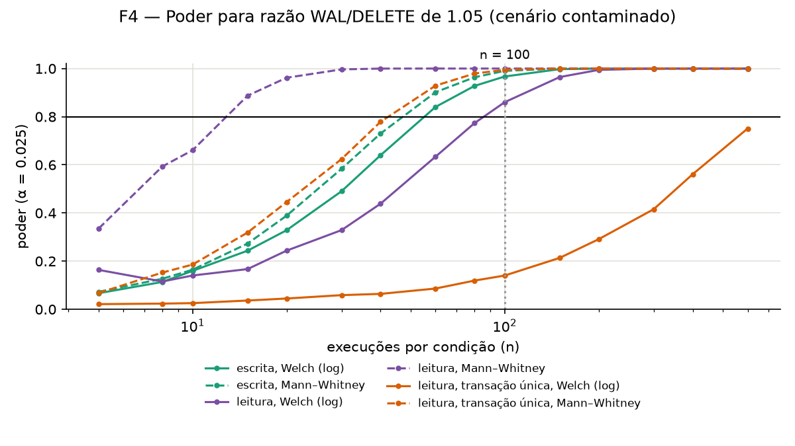
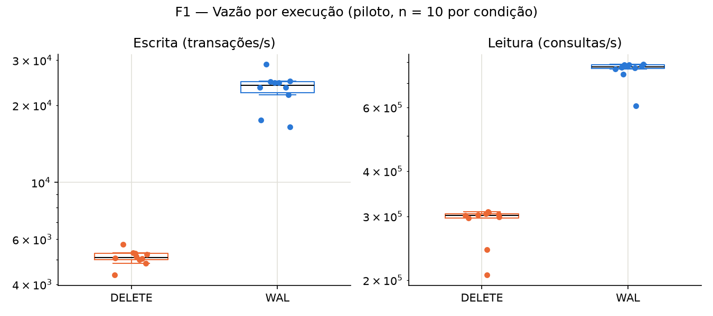
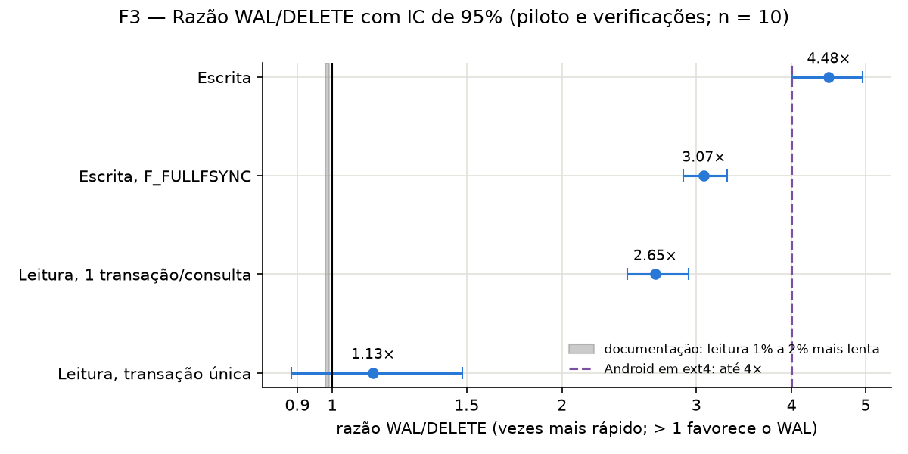
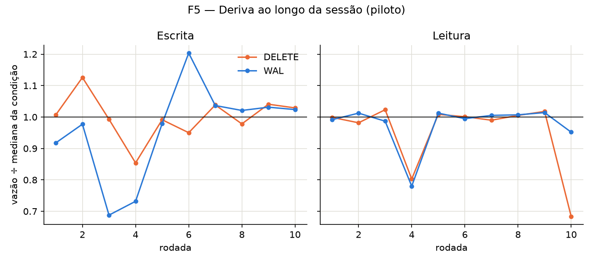

# Lab05S01 — Plano de análise e tamanho amostral (#76)

Complementa a [proposta](proposta.md) (#74, seções 7 e 8) e as [ameaças e decisões de medição](ameacas-medicao.md)
(#79). Papel C (Análise e Impacto): Tavares. Os números vêm do piloto (`lab05/data/pilot.csv`, 10
execuções por condição) e das verificações de validade (`lab05/data/validation.csv`, 10 por variante),
e os resultados da simulação ficam em `lab05/data/power.json`.

## 1. Decisão

| Item | Decisão |
|---|---|
| Efeito mínimo de interesse | razão WAL/DELETE de **1,05** (5%) |
| Nível de significância | 0,05, com Holm; cada uma das duas hipóteses principais é planejada a **α = 0,025** (pior caso do Holm) |
| Poder | 80% |
| **n por condição** | **100 execuções analisadas + 2 de aquecimento descartadas = 102 rodadas** |
| Quem determina o n | Welch sobre a vazão de leitura, no cenário com contaminação (86% de poder com 100; 77% com 80) |
| Tempo da coleta | cerca de **14 minutos** (13 deles no `fullfsync=1`) |
| Teste primário | escrita: Welch em log; leitura, variantes e `fullfsync`: Mann–Whitney. O outro teste sempre é reportado |
| Tamanho do efeito | razão das médias geométricas com IC de 95% por bootstrap, g de Hedges (em log) e probabilidade de superioridade |

A coleta completa (#77) deve rodar 102 rodadas, com as quatro cargas em ordem sorteada em cada rodada,
e a análise (#78) usa as 100 últimas.

## 2. Unidade de análise e escalas

A unidade é a **execução**: cada uma usa um banco novo, então as execuções são independentes. Todas as
métricas estão em escala de razão (ver [ameaças](ameacas-medicao.md), seção 1), o que permite média,
média geométrica, razões e testes paramétricos. Como o efeito de interesse é uma razão ("WAL é X vezes
mais rápido"), a análise acontece em **log**: a diferença das médias de log é o log da razão entre as
médias geométricas, como o Lab04 fez com log(horas).

## 3. Teste e tamanho do efeito por métrica

| Métrica | Papel | Teste | Tamanho do efeito | Por quê |
|---|---|---|---|---|
| M1 vazão de escrita | Principal | Welch em log | Razão de médias geométricas, g de Hedges | Normalidade em log não rejeitada no piloto (Shapiro–Wilk p = 0,07 e 0,41); σ diferente entre os modos pede Welch |
| M3 vazão de leitura | Principal | Mann–Whitney | Razão, probabilidade de superioridade | Shapiro rejeita em log nos dois modos (p < 0,001): execuções lentas ocasionais |
| Leitura em transação única; escrita com `fullfsync=1` | Sensibilidade | Mann–Whitney | Idem | Mesma razão; no piloto, Shapiro rejeita nos dois modos |
| M2 e M4 latência p95 (e p99, máxima) | Secundária | Só descrição e IC por bootstrap | Razão das medianas | O Mann–Whitney fica liberal quando os σ diferem muito (erro tipo I de até 5,4% em α = 2,5% na p95 de escrita), então não se faz inferência confirmatória |
| M5 razão WAL/DELETE | Derivada | IC de 95% por bootstrap | A própria razão | Q4: comparar o IC com 4× (Android em ext4) e 0,98 a 0,99 (documentação) |
| Rodada e posição na rodada | Ordinal | Correlação de postos de Spearman | ρ | Deriva (já em `lab05.validation`) |

Regras definidas antes da coleta:

- **O teste primário de cada métrica está fixado acima**, com base no piloto, e não muda depois de ver os
  dados da coleta. O outro teste é reportado como confirmação; se discordarem, os dois aparecem no
  resultado e a conclusão fica restrita ao que ambos sustentam.
- **Família principal:** H0-escrita e H0-leitura, com correção de Holm a 5%. **Família de sensibilidade:**
  leitura em transação única e escrita com `fullfsync=1`, com Holm próprio. Métricas secundárias não
  entram em nenhuma família.
- **Nenhuma execução é removida por valor.** Execuções lentas ocasionais fazem parte do comportamento
  medido; o Mann–Whitney e o bootstrap lidam com elas. Só se descarta (a) as 2 rodadas de aquecimento e
  (b) execução cuja validação falhe (erro do SQLite, número de operações diferente do previsto).
- **Análise de sensibilidade com bloco:** como as quatro condições rodam em cada rodada, repete-se a
  comparação sobre a razão WAL/DELETE por rodada (Wilcoxon de postos sinalizados). No piloto, a correlação
  entre os modos dentro da rodada foi 0,60 na leitura e 0,38 na escrita (em log), e as duas condições de
  leitura caíram juntas na rodada 4 (F5), então o bloco pode reduzir a variância. Com 10 rodadas isso é
  indício fraco, e por isso o n **não** conta com esse ganho.

Aplicação ilustrativa ao piloto (n = 10; `lab05.analysis.compare`). Os testes são só um ensaio da análise:

| Métrica | Razão WAL/DELETE (IC 95%) | p Welch (log) | p Mann–Whitney | g de Hedges | P(WAL > DELETE) |
|---|---|---:|---:|---:|---:|
| Vazão de escrita | 4,48× (4,01 a 4,95) | 6 × 10⁻¹² | 2 × 10⁻⁴ | 11,1 | 1,00 |
| Vazão de leitura | 2,65× (2,43 a 2,93) | 5 × 10⁻¹² | 2 × 10⁻⁴ | 8,5 | 1,00 |
| Leitura, transação única | 1,13× (0,88 a 1,48) | 0,40 | 0,79 | 0,4 | 0,46 |
| Escrita, `fullfsync=1` | 3,07× (2,88 a 3,29) | 2 × 10⁻¹⁶ | 2 × 10⁻⁴ | 13,4 | 1,00 |

Com n = 10, o menor p possível do Mann–Whitney é 2 × 10⁻⁴; o IC da transação única, de 0,88 a 1,48, mostra
por que essa variante é a que exige mais execuções.

## 4. Tamanho amostral

### Método

Simulação de poder no mesmo molde do Lab04 (`python -m lab05.power`), reaproveitando dele o par Welch ×
Mann–Whitney vetorizado (`lab04.robustness._rejection_rates`) e a regra do menor n da grade que alcança a meta
(`lab04.power.smallest_n_reaching`). 5.000 repetições por combinação, semente 42. As diferenças em relação
ao Lab04:

- **σ por modo.** O Lab04 usou um σ agrupado; aqui cada modo tem a média e o desvio de log da própria
  condição, porque o Welch existe para variâncias diferentes (escrita: σ de 0,07 em DELETE e 0,17 em WAL).
- **Efeito como razão.** O segundo grupo (WAL) é multiplicado por 1,02; 1,05; 1,10 ou 1,25. Com razão 1
  mede-se o erro tipo I.
- **Welch em log.** Como na análise real. O Mann–Whitney não muda com a transformação.
- **α = 0,025**, o limiar do menor p na correção de Holm com duas hipóteses.
- **Três cenários**, porque o piloto tem execuções lentas ocasionais e σ vindo de apenas 10 execuções:
  1. *Lognormal:* média e DP de log do piloto (o σ já inclui as execuções atípicas).
  2. *Contaminada (base do n):* σ robusto (MAD) e execuções atípicas (a mais de 3 MAD da mediana) com a
     frequência e o desvio observados no piloto, iguais nos dois modos para que a hipótese nula valha.
  3. *σ superior:* lognormal com σ no limite superior de 95% (1,64× o amostral, qui-quadrado com 9 g.l.).

### Resultado: menor n da grade com 80% de poder para razão 1,05 (α = 0,025)

Grade: 5, 8, 10, 15, 20, 30, 40, 60, 80, 100, 150, 200, 300, 400, 600. "> 600" significa que nenhum valor
da grade alcança 80%.

| Métrica | Aprox. normal (Welch) | Lognormal (Welch / MW) | **Contaminada (Welch / MW)** | σ superior (Welch / MW) |
|---|---:|---:|---:|---:|
| Vazão de escrita (principal) | 135 | 150 / 150 | **60 / 60** | 400 / 400 |
| Vazão de leitura (principal) | 97 | 100 / 150 | **100 / 15** | 300 / 300 |
| Leitura, transação única | 798 | > 600 / > 600 | **> 600 / 60** | > 600 / > 600 |
| Escrita com `fullfsync=1` | 52 | 60 / 60 | 60 / 15 | 150 / 150 |
| Latência p95, escrita (secundária) | 976 | > 600 / > 600 | > 600 / 300 | > 600 / > 600 |
| Latência p95, leitura (secundária) | 1.004 | > 600 / > 600 | > 600 / 60 | > 600 / > 600 |

### Como o n sai da tabela

Regra: para cada métrica de projeto (as duas principais e a leitura em transação única) no cenário
contaminado, vale o n do teste com **menos** poder, de modo que a conclusão não dependa de qual dos dois
testes é o primário. Onde um teste nunca alcança 80% (Welch na transação única), vale o Mann–Whitney.

- Escrita: 60 (os dois testes).
- Leitura: 100, determinado pelo Welch. Poder com n = 100: 86% (Welch) e 100% (Mann–Whitney).
- Transação única: 60, só com Mann–Whitney (poder de 93% com 60 e 99% com 100; o Welch fica em 14% com 100).
- **n = 100 por condição**, o maior dos três, e **+ 2 de aquecimento = 102 rodadas**.

Poder com n = 100 e razão 1,05 no cenário contaminado:

| Métrica | Welch | Mann–Whitney |
|---|---:|---:|
| Vazão de escrita | 96,7% | 99,0% |
| Vazão de leitura | 86,0% | 100% |
| Leitura, transação única | 14,0% | 99,5% |



### Verificações e limites desta estimativa

- **Erro tipo I.** Para as métricas de projeto, nos três cenários e com n ≥ 10, a taxa de rejeição com razão 1
  fica entre 0,7% e 3,1% no Welch e entre 1,8% e 4,0% no Mann–Whitney, contra o α de 2,5%. Valores abaixo
  de 2,5% são conservadores. O pior caso é o Mann–Whitney com σ muito diferentes entre os modos (escrita,
  cenário σ superior, 4,0% com n = 300). Nas secundárias o Mann–Whitney chega a 5,4% (latência p95 de
  escrita, com σ quatro vezes maior no WAL), e essa é a razão da regra de só descrever essas métricas.
- **Coerência com a fórmula.** A aproximação normal para a vazão de escrita (135) fica entre as estimativas
  da simulação com contaminação (60) e sem ela (150), como se espera. A estimativa preliminar da proposta
  (~160 para 5%) partia só do maior CV do piloto, sem separar o σ de cada modo. A simulação dá menos que a
  fórmula quando o ruído vem de poucas execuções atípicas sobre um σ de base pequeno (2% a 5%), que é o que
  o piloto mostra.
- **O cenário contaminado é otimista para o Mann–Whitney.** Os 100% de poder da leitura dependem de um σ
  de base de 2% e de estimar a frequência das execuções atípicas (10% a 30%) com 10 execuções por modo.
  Por isso o n é fixado pelo Welch, não pelo Mann–Whitney.
- **Cenário σ superior.** Se o ruído real for 1,64× o do piloto, 100 execuções não bastam para 5% (seriam
  300 a 400). Para a leitura em transação única, nenhum n da grade serve com Welch.
- **O piloto mede menos que a coleta final.** A leitura do piloto faz 5.000 consultas por execução e a
  coleta final fará 20.000, o que tende a reduzir o ruído; o `fullfsync=1` usa 500 transações por execução.
- **Mann–Whitney com aproximação normal e correção de continuidade**, como no Lab04. O piso de n vale: com
  Holm (α = 0,025) são necessárias pelo menos 5 execuções por grupo, porque com 4 o menor p possível é 0,029.

### Regra de reestimação do n

Depois das 2 rodadas de aquecimento e de 30 rodadas analisáveis, e **sem olhar a diferença entre os modos**,
os parâmetros do cenário contaminado (σ robusto, frequência e desvio das execuções atípicas) são reestimados
com as execuções já coletadas, e `python -m lab05.power` roda de novo. Se o n necessário passar de 100,
estende-se a coleta até esse valor, com teto de 300 rodadas (cerca de 40 minutos); acima disso, o teto vira
limitação declarada. Reduzir o n não é permitido: o menor valor é o desta seção.

## 5. Orçamento de tempo

Tempo por execução com as cargas da coleta final (leitura com 20.000 consultas), a partir das vazões médias
do piloto e das verificações, mais 0,05 s de preparo do banco por execução.

| Carga | DELETE (s) | WAL (s) | Total com 102 rodadas |
|---|---:|---:|---:|
| Escrita, 1.000 transações | 0,25 | 0,09 | 35 s |
| Leitura, 20.000 consultas por transação | 0,12 | 0,08 | 20 s |
| Leitura, transação única | 0,07 | 0,06 | 13 s |
| Escrita com `fullfsync=1`, 500 transações | 5,82 | 1,93 | 791 s |
| **Total** | | | **cerca de 14 minutos** |

O custo está quase todo no `fullfsync=1`. Mesmo com o teto de 300 rodadas da regra de reestimação, a coleta
leva cerca de 40 minutos, então o tempo não limita o n.

## 6. Visualizações (esboço com os dados do piloto)

`python -m lab05.plots` gera as cinco figuras em `docs/lab05/figuras/`. Cada modo de journal tem cor fixa
(DELETE laranja, WAL azul). Na análise completa (#78), os mesmos gráficos passam a usar os dados da coleta.

| Figura | O que mostra | Onde entra no documento | Escala |
|---|---|---|---|
| F1 — vazão por condição | Caixa e pontos de cada execução, escrita e leitura | Resultados | Log |
| F2 — distribuição acumulada do p95 | Cauda das latências por modo | Resultados (cauda; Falácia de McNamara) | Log |
| F3 — razão WAL/DELETE com IC | A resposta a Q4, com as referências de 4× (Android) e 0,98 a 0,99 (documentação) | Resultados e conclusão | Log |
| F4 — poder × n | Justifica o n | Método | Log no n |
| F5 — vazão por rodada | Deriva e choques comuns às duas condições | Ameaças à validade | Linear, relativa à mediana |







## 7. Formato do documento

O documento final continua sendo [documento.md](documento.md), o rascunho de #81: Markdown, versionado no
repositório, com as figuras PNG (150 dpi) em `docs/lab05/figuras/`. Escolhido porque é revisável por diff,
reproduzível por script e não depende de ferramenta externa. A estrutura segue a seção 8 do enunciado:

1. O software e os três critérios, com números e fontes.
2. A pergunta de pesquisa e o caminho.
3. As 7 categorias, com justificativa.
4. Os conceitos da disciplina aplicados (GQM, escalas, Goodhart, ameaças, poder).
5. O que veio dos laboratórios anteriores e o que é novo.
6. Resultados: F1, F2 e F3 com os testes e os tamanhos do efeito deste plano.
7. Ameaças à validade (4 tipos), com F5 e a evidência medida.
8. Impacto (#80) e o que não é possível afirmar.

A apresentação de 10 minutos reaproveita F3 (resultado), F4 (por que 100 execuções) e F5 (o que deu errado
no piloto e como foi tratado).

## 8. Reprodução

```bash
python -m lab05.power   # grava lab05/data/power.json (cerca de 5 minutos)
python -m lab05.plots   # grava as figuras
python -m pytest lab05/tests -q
```

Código: `lab05/power.py` (simulação, n e orçamento), `lab05/analysis.py` (testes e tamanho do efeito),
`lab05/plots.py` (figuras).
