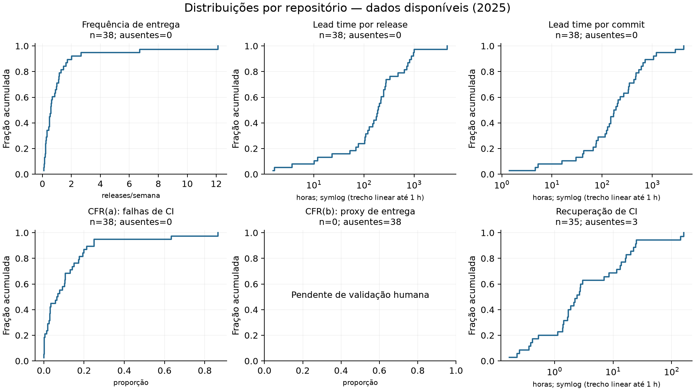
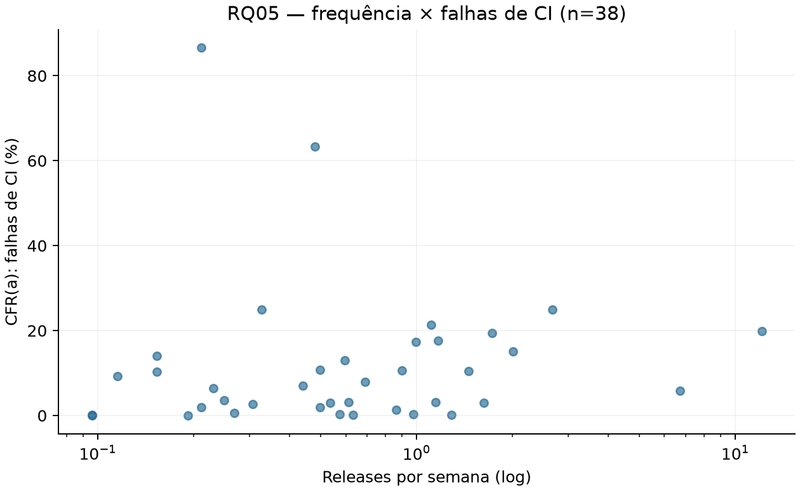
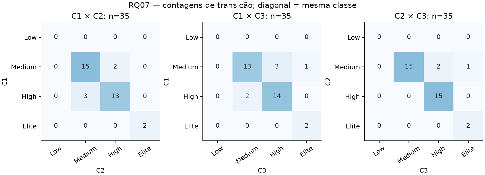
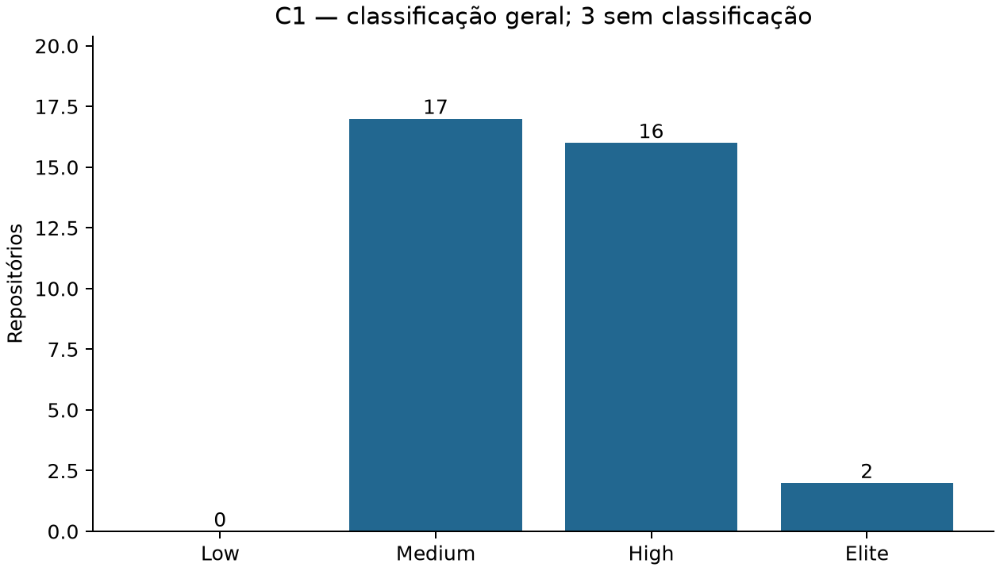

# Resultados e discussão — execução exploratória

**Entrega incompleta. Não utilizar como resultado final da Lab03S03.**

- Amostra parcial: 38/300 elegíveis (#50).
- CFR(b) sem validação da heurística contra três avaliações e consenso (#45–49).

Janela: 2025-01-01T00:00:00Z até 2026-01-01T00:00:00Z (fim exclusivo).

| Métrica | n | Mediana | Q1–Q3 | Ausentes |
|---|---:|---:|---:|---:|
| Frequência de entrega (releases/semana) | 38 | 0.585 | 0.254–1.14 | 0 |
| Lead time por release (horas) | 38 | 191 | 104–316 | 0 |
| Lead time por commit (horas) | 38 | 181 | 78.7–456 | 0 |
| CFR(a): falhas de CI (proporção) | 38 | 0.0677 | 0.0196–0.148 | 0 |
| CFR(b): proxy de entrega (proporção) | 0 | — | —–— | 38 |
| Recuperação de CI (horas) | 35 | 2.42 | 1.39–13.6 | 3 |

## RQ05–06

- cfr_ci: n=38, rho=0.276, p=0.0931; ok.
- cfr_delivery: n=0, rho=—, p=—; insufficient_or_constant.

RQ06: 15 testes válidos, 1 com p ajustado < 0,05. Resultados por fator, tamanho de efeito e Holm estão em rq06.csv; medianas e IQR por grupo em rq06_groups.csv.

## RQ07

C1 usa release/lead time(a)/CFR(a); C2 altera apenas lead time para (b); C3 inclui pré-releases e lead time(b), mantendo CFR(a). C4 testa CFR(b), quando validado. Todas mantêm recuperação de CI. Assim é possível distinguir o efeito de cada definição. A variante tag não é estimada: a data do commit não comprova a data da tag.

| Par | n pareado | Mudaram (%) | Kappa linear |
|---|---:|---:|---:|
| C1 x C2 | 35 | 14.3 | 0.765 |
| C1 x C3 | 35 | 17.1 | 0.683 |
| C1 x C4 | 0 | — | — |
| C2 x C3 | 35 | 8.57 | 0.82 |
| C2 x C4 | 0 | — | — |
| C3 x C4 | 0 | — | — |

## Limitações e interpretação

A amostra parcial favorece projetos processados primeiro e não permite generalizar os resultados. Não concluir causalidade a partir de correlações nem equivalência entre falhas de CI e incidentes em produção. Medianas de recuperação descrevem apenas episódios encerrados; os censurados são preservados no dataset. Nenhum episódio observado não equivale a recuperação instantânea. Ausências impedem classificação geral.

Estrelas e contribuidores foram medidos na coleta, fora da janela histórica; são covariáveis atuais. Lead time(a) enfatiza o commit mais antigo de cada release; (b) pondera inclusões individuais de commits. Diferenças entre as variantes podem refletir commits antigos e tamanhos distintos das releases. Significância estatística deve ser lida com o tamanho de efeito e a seleção da amostra. Os testes e pares sem dados permanecem explicitamente ausentes.
