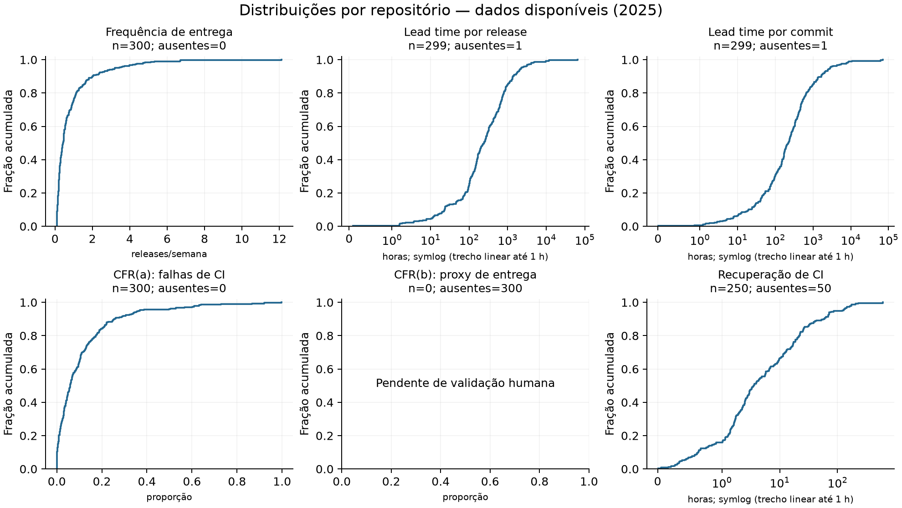
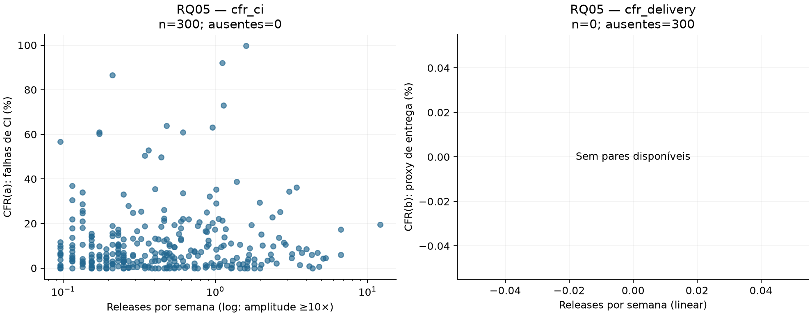
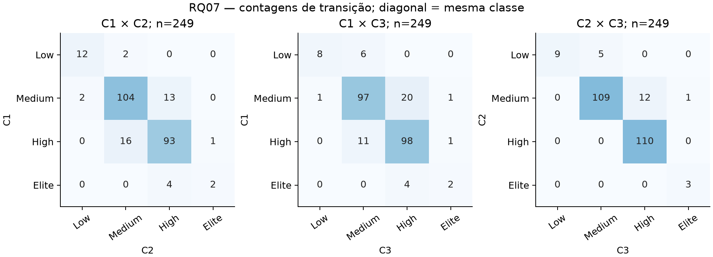
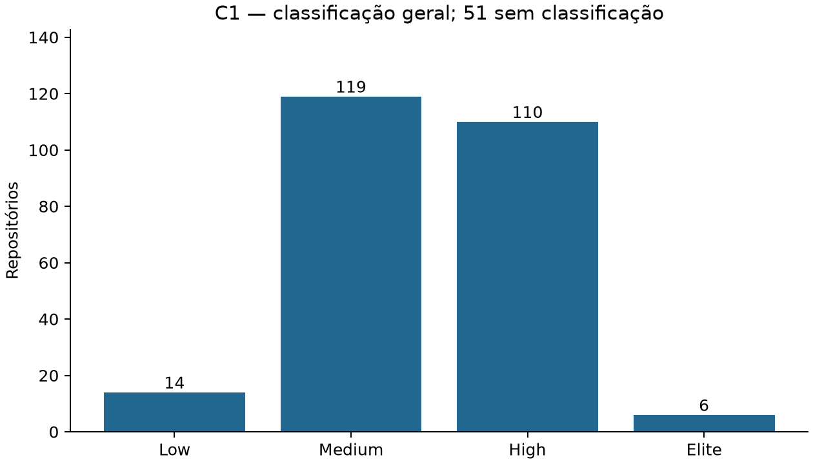

# Resultados e discussão — execução exploratória

**Entrega incompleta. Não utilizar como resultado final da Lab03S03.**

- CFR(b) sem validação da heurística contra três avaliações e consenso (#45–49).

Janela: 2025-01-01T00:00:00Z até 2026-01-01T00:00:00Z (fim exclusivo).

| Métrica | n | Mediana | Q1–Q3 | Ausentes |
|---|---:|---:|---:|---:|
| Frequência de entrega (releases/semana) | 300 | 0.432 | 0.211–0.978 | 0 |
| Lead time por release (horas) | 299 | 243 | 100–681 | 1 |
| Lead time por commit (horas) | 299 | 220 | 76.6–521 | 1 |
| CFR(a): falhas de CI (proporção) | 300 | 0.0592 | 0.0174–0.137 | 0 |
| CFR(b): proxy de entrega (proporção) | 0 | — | —–— | 300 |
| Recuperação de CI (horas) | 250 | 3.54 | 1.5–17 | 50 |

## RQ05–06

- cfr_ci: n=300, rho=0.0385, p=0.507; ok.
- cfr_delivery: n=0, rho=—, p=—; insufficient_or_constant.

RQ06: 15 testes válidos, 3 com p ajustado < 0,05. Resultados por fator, tamanho de efeito e Holm estão em rq06.csv; medianas e IQR por grupo em rq06_groups.csv.

A hipótese prévia de RQ05 prevê associação fraca e possíveis sinais distintos entre os proxies. Comparar magnitude e sinal de rho para cada CFR, considerando n e p; p alto não comprova associação fraca. Sem pares de CFR(b), a comparação entre proxies permanece pendente. Os gráficos usam frequência em log somente quando todos os valores são positivos e a amplitude é de pelo menos 10 vezes; zeros permanecem visíveis em escala linear.

RQ06 confronta a expectativa de diferenças por escala mediante quartis de estrelas e contribuidores; idade é o terceiro fator exploratório permitido. A hipótese original também citava linguagem: ela não é testada nesta implementação e não pode ser confirmada ou refutada pelos fatores escolhidos. Empates colapsam limites dos quartis, grupos com menos de dois itens não geram teste e ausências são contabilizadas. Ausência de rejeição após Holm não demonstra igualdade; interpretar p ajustado com medianas, IQR e tamanho de efeito. Esta execução parcial fornece diagnóstico exploratório; o confronto final das hipóteses depende da amostra completa e da validação humana.

## RQ07

C1 usa release/lead time(a)/CFR(a); C2 altera apenas lead time para (b); C3 inclui pré-releases e lead time(b), mantendo CFR(a). C4 testa CFR(b), quando validado. Todas mantêm recuperação de CI. Assim é possível distinguir o efeito de cada definição. A variante tag não é estimada: a data do commit não comprova a data da tag.

| Par | n pareado | Mudaram (%) | Kappa linear |
|---|---:|---:|---:|
| C1 x C2 | 249 | 15.3 | 0.761 |
| C1 x C3 | 249 | 17.7 | 0.712 |
| C1 x C4 | 0 | — | — |
| C2 x C3 | 249 | 7.23 | 0.876 |
| C2 x C4 | 0 | — | — |
| C3 x C4 | 0 | — | — |

## Limitações e interpretação

A amostra parcial favorece projetos processados primeiro e não permite generalizar os resultados. Não concluir causalidade a partir de correlações nem equivalência entre falhas de CI e incidentes em produção. Medianas de recuperação descrevem apenas episódios encerrados; os censurados são preservados no dataset. Nenhum episódio observado não equivale a recuperação instantânea. Ausências impedem classificação geral.

Estrelas e contribuidores foram medidos na coleta, fora da janela histórica; são covariáveis atuais. Lead time(a) enfatiza o commit mais antigo de cada release; (b) pondera inclusões individuais de commits. Diferenças entre as variantes podem refletir commits antigos e tamanhos distintos das releases. Significância estatística deve ser lida com o tamanho de efeito e a seleção da amostra. Os testes e pares sem dados permanecem explicitamente ausentes.
